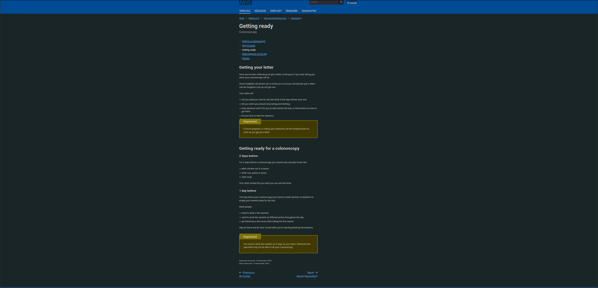

# Analýza existujúcich riešení

**Skúmaná úloha:** zistiť, ako sa pripraviť na vyšetrenie, čo urobiť pri probléme a ako sa dostať ku kontaktu alebo aktuálnym informáciám.

**Metóda, 7. 10. 2026:** otvorenie a čítanie verejných stránok, sledovanie odkazov na prípravu a MyChart. Ide o analýzu dostupného obsahu, nie testovanie s pacientmi. Pri NHS je priložená snímka dodaná používateľom. Do pacientskych účtov sa neprihlasovalo, rezervácie sa nemenili a pracoviská sa nekontaktovali.

Silné a slabé stránky nižšie sú odborné posúdenie návrhu. Nejde o nameranú úspešnosť používateľov. Ak funkcia nie je na skúmanej stránke, neznamená to, že ju daná organizácia neposkytuje iným spôsobom.

## R01: NHS – Getting ready for a colonoscopy

[Verejná stránka, S01](https://www.nhs.uk/tests-and-treatments/colonoscopy/getting-ready/)

**Pozorovanie:** obsah je rozdelený na prijatie listu a dni prípravy. Upozornenia sú oddelené od bežného textu. Stránka odkazuje na individuálne pokyny v liste.

**Silná stránka:** časové členenie pomáha orientácii; zvýraznené upozornenia majú vlastný textový nadpis.

**Obmedzenie pre našu úlohu:** ide o všeobecný článok. Na skúmanej stránke pacient nezaznamená plnenie krokov ani neuvidí svoj nový termín.

**Dôsledok N03/N10:** zachovať členenie podľa času a doplniť konkrétny dátum a pacientom označený stav.

Snímka dokladá sekcie o liste, dňoch prípravy a upozorneniach. Farebná téma môže byť ovplyvnená nastavením prehliadača; nie je podkladom pre tvrdenie o predvolenej farebnosti NHS.

## R02: Guy’s and St Thomas’ – príprava na kolonoskopiu

[Verejný sprievodca, S03](https://www.guysandstthomas.nhs.uk/health-information/colonoscopy-diet-advice-and-bowel-preparation)

**Pozorovanie:** sprievodca má časové podstránky, vysvetlenie prípravy a kontaktnú cestu pri ťažkostiach. Výber prípravku patrí pracovisku.

**Silná stránka:** praktický obsah rozlišuje situácie, ktoré treba prebrať so zdravotníkom.

**Obmedzenie pre našu úlohu:** text a prechody medzi stránkami vyžadujú, aby si pacient sám spojil pokyny so svojím termínom. V skúmanom verejnom sprievodcovi sa nezaznamenáva dokončenie.

**Dôsledok N05/N07:** zobraziť schválený plán a kontakt priamo pri problematickom kroku.

**Časť vhodná na snímku:** navigácia dní a sekcia „Contact the endoscopy unit if“. Snímka v tomto balíku nie je; obsah bol otvorený a prečítaný.

## R03: MyChart – pacientsky portál

[Oficiálny verejný opis, S05](https://www.guysandstthomas.nhs.uk/mychart)

**Deklarované funkcie:** prístup k listom a zdravotným informáciám, podpora pomáhajúcich osôb cez proxy access a helpdesk. Opis odlišuje službu od urgentnej pomoci.

**Silná stránka podľa dokumentácie:** pacient môže nájsť dokumenty na jednom mieste; pomoc blízkej osoby má pomenovaný spôsob prístupu.

**Obmedzenie analýzy:** bez oprávneného účtu nebolo možné skúmať prípravu, upozornenia ani zmenu termínu v aplikácii. Ich kvalitu nemožno hodnotiť z verejného opisu.

**Dôsledok N08:** prepojiť plán s pôvodnými dokumentmi, vysvetliť dostupnosť pomoci a zdieľanie ponechať pod kontrolou pacienta.

**Časť vhodná na snímku:** verejný opis funkcií a proxy access; nejde o obrazovku samotnej aplikácie. Snímka nie je priložená.

## R04: UNLP Košice – stránka endoskopického pracoviska

[Verejná stránka, S06](https://unlp.sk/ambulancia/endoskopicke-pracovisko/)

**Pozorovanie:** stránka identifikuje pracovisko, uvádza kontakt a dátum aktualizácie.

**Silná stránka:** lokálny kontakt je dostupný bez pacientského účtu.

**Obmedzenie pre našu úlohu:** na tejto stránke sa nenašiel osobný plán, časová príprava ani evidencia krokov. Zistenie sa týka iba otvorenej stránky, nie všetkých služieb UNLP.

**Dôsledok N09:** pacient má pri pláne vidieť správne pracovisko a dostupný kontakt.

**Časť vhodná na snímku:** názov pracoviska a Kontakt. Snímka nie je priložená.

## Vzory, rozdiely a závery

| Pozorovaný vzor | Kde | Dôsledok pre návrh |
| --- | --- | --- |
| Príprava členená podľa času | R01/R02 | Časové skupiny doplniť o dátumy odvodené zo schváleného plánu. |
| Pokyny majú autora – poskytovateľa starostlivosti | R01/R02 | Uvádzať pracovisko a aktuálnu verziu pokynov. |
| Kontakt je dostupný spolu s informáciami | R02/R04 | Viditeľná akcia „Kontaktovať pracovisko“; dostupnosť overiť. |
| Dokumenty a pomoc blízkych v portáli | R03, podľa dokumentácie | Prepojiť originálne pokyny; zdieľanie je voliteľný ďalší rozsah. |
| Verejný text neukazuje osobný stav prípravy | R01/R02/R04 | Navrhnúť vlastné stavy krokov; ich prínos overiť s pacientmi. |

**Návrhový záver:** kombinovať časový plán, pôvodné pokyny, pacientom zaznamenané kroky a kontakt. Téma projektu navyše vyžaduje zmenu termínu a nesplnenie pokynov; v týchto situáciách má byť výsledkom zrozumiteľný ďalší postup, nie automatické potvrdenie zdravotnej pripravenosti.

**Limity:** jedna skutočná snímka, tri ďalšie riešenia analyzované podľa verejného textu. Žiadne tvrdenie o vnútornej funkčnosti MyChart ani o používateľskej úspešnosti. Po získaní prístupu možno doplniť reálne prejdenie úlohy a snímky príslušných stavov.
