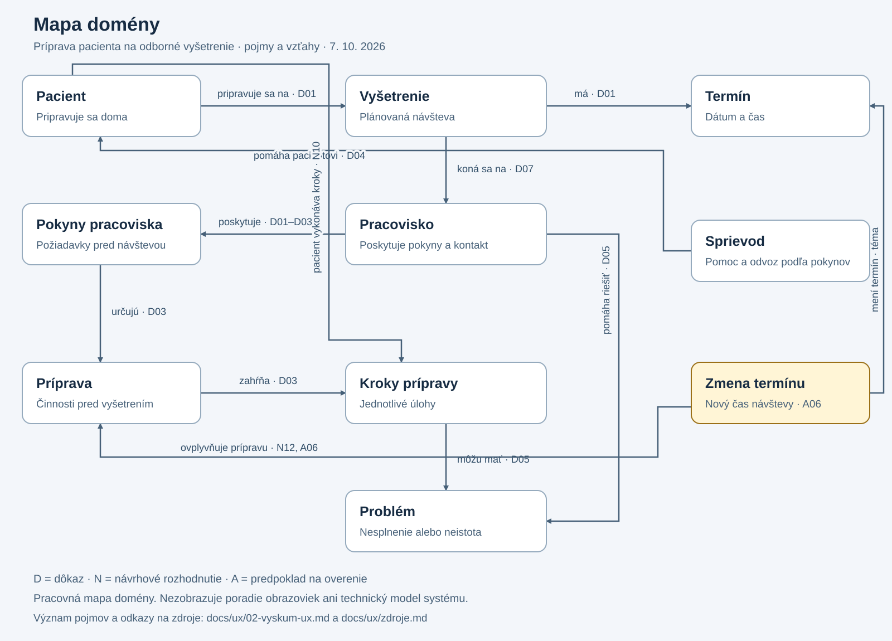

# Výskum UX

**Téma:** Príprava pacienta na odborné vyšetrenie. Rozhranie prevedie pacienta prípravou, upozorní na chýbajúce kroky a reaguje na zmenu termínu alebo nesplnenie pokynov.

**Metóda:** dokumentačná rešerš primárnych zdrojov a analýza verejných stránok, 7. 10. 2026. Zdroje S01–S08 sú prepojené v [registri](zdroje.md). Neboli získané rozhovory ani pozorovania pacientov.

## 1. ČO: problém a cieľ

**D01 – dôkaz:** príprava na kolonoskopiu obsahuje viacero pokynov viazaných na dni pred vyšetrením a na list od nemocnice. [NHS, S01](https://www.nhs.uk/tests-and-treatments/colonoscopy/getting-ready/)

**A01 – predpoklad:** pacient môže mať problém spojiť termín, textové pokyny a vlastné vykonané kroky do aktuálneho plánu. Miera výskytu tohto problému v cieľovom pracovisku zatiaľ nie je známa.

**N01 – návrhové rozhodnutie:** pripraviť sprievodcu, v ktorom pacient vidí aktuálny termín, čo má urobiť teraz, čo už označil ako splnené a kde získa pomoc. Úspechom je zrozumiteľný ďalší postup aj pri zmene alebo probléme. Samotné označenie krokov nepotvrdzuje zdravotnú spôsobilosť na vyšetrenie.

## 2. KDE: hranice domény

**N02 – zvolený rozsah:** príprava dospelého pacienta na plánované ambulantné vyšetrenie; pracovný príklad je kolonoskopia na jednom pracovisku. Začiatok je prijatie termínu a schválených pokynov. Koniec je príchod na pracovisko s prehľadom splnených krokov a otvorených problémov, prípadne prijatie aktualizovaného plánu.

Do domény patria termín, miesto, pokyny pracoviska, príprava doma, potrebné veci, sprievod podľa pokynov, pripomienky, hlásenie problému a zmena termínu.

Diagnostika, voľba liečby, výsledky vyšetrenia a samostatné určovanie dávok liekov sú mimo zvoleného rozsahu. Rozhranie sprostredkuje schválený pokyn; medicínsku zmenu musí určiť zdravotník.

## 3. Zainteresované strany a otvorené otázky

| Strana | Úloha v navrhovanom riešení | Stav poznania |
| --- | --- | --- |
| Pacient | Rozumie plánu, vykonáva kroky, oznamuje problém. | Cieľová skupina; konkrétne potreby A01–A04 sa overia. |
| Blízka osoba / sprievod | Pomáha podľa dohody s pacientom. | Potreba odvozu je doložená S02/S04; digitálne zdieľanie je A03. |
| Endoskopické pracovisko | Vlastník produktu v pracovnom návrhu; poskytuje termín a pokyny. | Výber konkrétneho partnera a vlastníctvo sú A05. |
| Lekár alebo sestra | Vysvetlí pokyn, posúdi problém, schváli zmenu plánu. | Individuálne posúdenie prípravy a liekov: S02/S03. |
| Administratíva pracoviska | Spracuje požiadavku na zmenu termínu. | Konkrétny postup a kompetencie sú A06. |
| Školiteľ / cvičiaci | Konzultuje rozsah a kvalitu výskumu. | Kontext semestrálneho zadania. |

Otázky pre ďalší výskum:

1. Ako pacient dostane termín a pokyny a čo urobí, keď im nerozumie?
2. Ktoré kroky sa najčastejšie nedokončia a ako sa to dnes rieši?
3. Kto schvaľuje nový plán po zmene termínu, najmä ak pacient už začal prípravu?
4. Aký postup platí mimo ordinačných hodín a aký čas odpovede možno pacientovi sľúbiť?
5. Čo pacient potrebuje vytlačiť a čo chce zdieľať so sprievodom?
6. Rozlišuje pacient „označil/a som ako splnené“ od „pracovisko posúdilo prípravu“?

## 4. KTO: cieľoví používatelia

| Skupina | Cieľ | Znalosti, potreby a obmedzenia | Podklad |
| --- | --- | --- | --- |
| **Primárna: dospelý pacient pripravujúci sa doma** | Vedieť čo, kedy a podľa ktorého pokynu vykonať; riešiť neistotu. | Znalosť medicínskej terminológie ani digitálna zručnosť sa nepredpokladajú. Potreba plánu a kontaktu je doménový záver; používanie mobilu a obavy sú A02/A04. | D01–D05; A01/A02/A04. |
| Blízka osoba | Pomôcť s prípravou a návštevou. | Potrebuje iba údaje, ktoré jej pacient sprístupní; oprávnenia v návrhu nie sú potvrdené výskumom. | D04/D06; A03. |
| Sestra alebo lekár | Odovzdať správne pokyny a posúdiť problém pacienta. | Nemá sa mu predkladať nepodložené automatické rozhodnutie o príprave. Dostupnosť a pracovná záťaž sa musia zistiť. | D02/D03/D05; A05/A06. |

Primárny návrh musí byť použiteľný aj po prerušení prípravy. Zobrazovanie pokroku vychádza z odporúčania W3C [S07](https://www.w3.org/WAI/WCAG2/supplemental/patterns/o1p04-clear-steps/); nejde o nameranú preferenciu pacientov.

## 5. Báza znalostí: dôkaz → dôsledok

| ID a dôkaz | Zdroj | Dôsledok pre návrh |
| --- | --- | --- |
| **D01:** list obsahuje termín a pokyny k jedlu, pitiu a príprave. | [NHS, S01](https://www.nhs.uk/tests-and-treatments/colonoscopy/getting-ready/) | **N03:** spojiť termín a prípravu v jednom prehľade; uvádzať pôvod pokynov. |
| **D02:** pacient má oznámiť zdravotné problémy a užívané lieky; dostáva písomnú prípravu. | [NIDDK, S02](https://www.niddk.nih.gov/health-information/diagnostic-tests/colonoscopy) | **N04:** úloha „Overiť pokyny k liekom s pracoviskom“; rozhranie neurčuje dávky. |
| **D03:** prípravok vyberá pracovisko; jeho dokumentácia rozlišuje fázy prípravy. | [Guy’s and St Thomas’, S03](https://www.guysandstthomas.nhs.uk/health-information/colonoscopy-diet-advice-and-bowel-preparation) | **N05:** plán vychádza z aktuálnej verzie pokynov konkrétneho pracoviska. |
| **D04:** pri sedácii môžu byť podmienkou návštevy sprievod a odvoz. | [Guy’s and St Thomas’, S04](https://www.guysandstthomas.nhs.uk/health-information/colonoscopy) | **N06:** zaradiť logistiku medzi kroky, iba ak ju vyžaduje daný plán. |
| **D05:** pri ťažkostiach znemožňujúcich dokončenie prípravy má pacient kontaktovať zdravotníka. | [NIDDK, S02](https://www.niddk.nih.gov/health-information/diagnostic-tests/colonoscopy) | **N07:** pri každom kroku ponúknuť „Mám problém“ a cestu ku kontaktu. |
| **D06:** verejný opis MyChart uvádza listy a prístup pre osoby pomáhajúce pacientovi; služba nie je určená na urgentné problémy. | [MyChart, S05](https://www.guysandstthomas.nhs.uk/mychart) | **N08:** odlíšiť bežný kontakt od urgentného postupu; zdieľanie riešiť výslovným rozhodnutím pacienta. |
| **D07:** stránka miestneho endoskopického pracoviska poskytuje telefónny kontakt. | [UNLP, S06](https://unlp.sk/ambulancia/endoskopicke-pracovisko/) | **N09:** mať viditeľný kontakt na konkrétne pracovisko; čas dostupnosti overiť. |
| **D08:** W3C odporúča ukazovať aktuálny, dokončené a zostávajúce kroky. | [W3C, S07](https://www.w3.org/WAI/WCAG2/supplemental/patterns/o1p04-clear-steps/) | **N10:** textové stavy a ďalší krok; nespoliehať sa iba na farbu. |
| **D09:** W3C odporúča voliteľné a prispôsobiteľné pripomienky. | [W3C, S08](https://www.w3.org/WAI/WCAG2/supplemental/patterns/o7p07-reminders/) | **N11:** pacient si vyberie spôsob pripomenutia a môže ho zmeniť. |

## 6. Stručné závery výskumu

| Záver | Opora | Navrhovaná odpoveď |
| --- | --- | --- |
| Príprava súvisí s termínom a konkrétnymi pokynmi. | D01/D03. | N03/N05: aktuálny plán s časmi a pôvodom pokynov. |
| Medicínsku neistotu nemožno vyriešiť automatickým označením kroku. | D02/D05 a návrhový záver. | N04/N07: bezpečná cesta k zdravotníkovi. |
| Logistika môže byť súčasťou prípravy. | D04. | N06: sprievod a potrebné veci podľa plánu. |
| Pri prerušení je užitočná orientácia v stave úlohy. | D08; prenos do tejto témy je návrhový záver. | N10: teraz / splnené / zostáva / problém. |
| Pripomienky majú rešpektovať voľbu používateľa. | D09. | N11: nastavenie pripomienok. |
| Zmena termínu musí byť pokrytá, ale jej lokálny postup nie je známy. | Téma projektu; A06. | **N12:** ukázať pôvodný a nový termín, zmeny krokov a potrebu posúdenia pracoviskom. |

Nie je podložené, že tento návrh zníži počet zrušených vyšetrení. To je cieľ na neskoršie vyhodnotenie, nie výsledok tejto rešerše.

## 7. Pracovný profil primárneho používateľa

**Proto-persona – hypotetický profil, nie skutočný respondent.**

„Pacient pripravujúci sa na prvé plánované vyšetrenie“ je dospelý človek, ktorý dostal termín a pokyny, ale ešte nemá skúsenosť s prípravou. Pracovný predpoklad A02 je, že vie používať jednoduché mobilné rozhranie; vek, povolanie ani presné zariadenie nie sú určené výskumom.

- **Cieľ:** prísť v správny čas a vedieť, čo treba ešte dokončiť.
- **Potreby navrhnuté z domény:** zrozumiteľný plán, dostupné pôvodné pokyny, kontakt, riešenie problému.
- **Predpokladané ťažkosti A01/A04:** neistota pri čítaní pokynov, obavy, prerušenie prípravy.
- **Situácia na overenie:** pacient otvorí plán po telefonickej zmene termínu a potrebuje zistiť, či jeho doterajšie kroky ešte platia.
- **Čo nevieme:** schopnosť čítať pokyny, digitálna gramotnosť, potreba pomoci a preferovaný spôsob pripomienok.

Profil sa po rozhovoroch upraví; neobsahuje vymyslené citácie ani demografické tvrdenia.

## 8. Kľúčové pojmy a mapa domény

| Pojem | Význam z pohľadu pacienta | Vzťah |
| --- | --- | --- |
| Vyšetrenie | Návšteva, na ktorú sa pripravujem. | Má termín a pracovisko. |
| Termín | Dátum a čas návštevy; podľa pokynov aj čas príchodu. | Určuje časový kontext prípravy. |
| Pracovisko | Miesto, ktoré ma objednalo a poskytlo pokyny. | Vydáva pokyny a ponúka kontakt. |
| Pokyny | Čo odo mňa pracovisko požaduje. | Tvoria základ plánu prípravy. |
| Príprava | Súbor vecí, ktoré vykonám pred návštevou. | Zahŕňa jedlo a pitie, pokyny k liekom, potrebné veci a logistiku podľa vyšetrenia. |
| Krok | Jedna zrozumiteľná úloha v príprave. | Má čas a pacientom zaznamenaný stav. |
| Problém | Niečo som nesplnil/a alebo tomu nerozumiem. | Súvisí s krokom a môže vyžadovať pomoc pracoviska. |
| Zmena termínu | Návšteva má iný dátum alebo čas. | Ovplyvňuje prípravu a dostupnosť sprievodu. |
| Sprievod | Osoba, ktorá mi pomôže podľa dohody. | Pomáha pacientovi; môže zabezpečiť odvoz. |

Mapa zachytáva doménové vzťahy, nie navigáciu obrazoviek ani databázu. Jej podkladmi sú D01–D07, téma projektu a označené návrhové rozhodnutia.

Editovateľný text diagramu: [mapa-domeny.mmd](diagrams/mapa-domeny.mmd). Model vlastností a používateľských akcií pokračuje v [cvičení 3](03-konceptualny-model.md).
