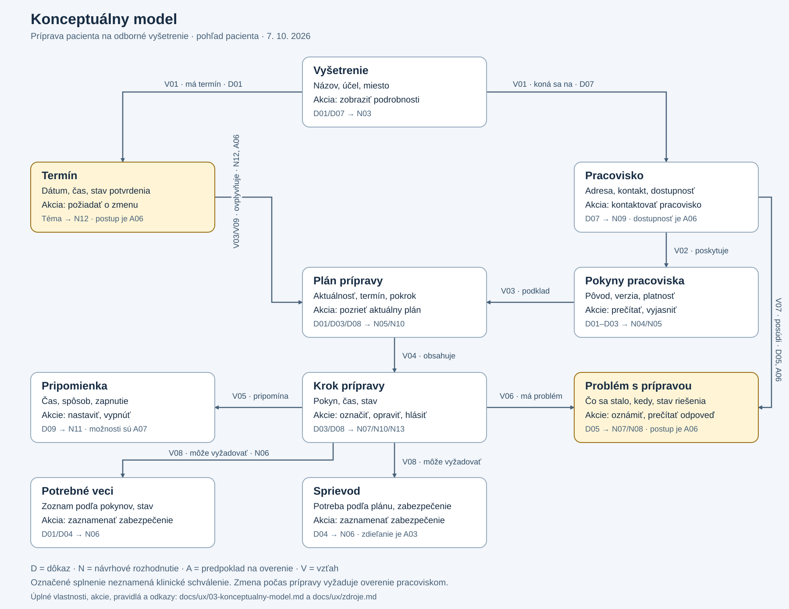

# Konceptuálny model

Model rozhrania pre **prípravu pacienta na odborné vyšetrenie**. Zachytáva pojmy, vlastnosti, vzťahy a akcie z pohľadu pacienta. Pracovným príkladom je kolonoskopia; medicínske časovanie a obsah krokov poskytuje pracovisko.

## 1. Východiská a hranice

Model vychádza zo [zistení D01–D09](02-vyskum-ux.md#5-báza-znalostí-dôkaz--dôsledok), [analýzy R01–R04](02-analyza-rieseni.md) a požiadavky reagovať na zmenu termínu a nesplnenie pokynov. Každá vlastnosť rozhrania je návrhové rozhodnutie Nxx; zdroje dokladajú jej doménový základ, nie existenciu budúceho produktu.

**N13:** pacient vidí stav „Všetky kroky označené ako splnené“, ak zaznamenal ich dokončenie. Tento stav neznamená schválenie prípravy zdravotníkom. Pokyny, ktoré ešte treba overiť, a otvorené problémy zostávajú viditeľné samostatne.

## 2. Pojmy, vlastnosti a používateľské akcie

| Pojem | Vlastnosti relevantné pre používateľa | Akcie pacienta | Opora |
| --- | --- | --- | --- |
| **Vyšetrenie** | Názov, účel v jednoduchom jazyku, pracovisko, aktuálny termín. | Zobraziť podrobnosti a miesto. | D01/D07; N03. |
| **Termín** | Dátum, čas, prípadný odlišný čas príchodu; potvrdený / požadovaná zmena. | Pozrieť termín, požiadať o zmenu, potvrdiť prečítanie oznámenej zmeny. | Téma projektu; N12; A06. |
| **Pracovisko** | Názov, adresa, kontakt, overené hodiny dostupnosti. | Zobraziť kontakt alebo ho použiť. | D07; N09; A06. |
| **Pokyny pracoviska** | Pôvod, dátum alebo verzia, platnosť pre dané vyšetrenie a termín. | Prečítať originál, požiadať o vysvetlenie. | D01–D03; N04/N05. |
| **Plán prípravy** | Aktuálny termín a pokyny, kroky, celkový prehľad; aktuálny / čaká na potvrdenie pracoviskom. | Pozrieť dnešné a všetky kroky, vrátiť sa po prerušení. | D01/D03/D08; N03/N05/N10. |
| **Krok prípravy** | Názov, stručný pokyn, čas alebo interval, stav, prípadná podmienka platnosti. | Prečítať, označiť splnenie, opraviť označenie, oznámiť problém. | D03/D08; N07/N10/N13. |
| **Pripomienka** | Súvisiaci krok alebo termín, čas, spôsob, zapnutá / vypnutá. | Zapnúť, zmeniť spôsob alebo vypnúť. | D09; N11; A07. |
| **Problém s prípravou** | Súvisiaci krok, čo sa stalo, čas, ďalší postup; otvorený / čaká na odpoveď / vyriešený pracoviskom. | Opísať problém, kontaktovať pracovisko, prečítať odpoveď. | D05; N07/N08; A06. |
| **Potrebné veci** | Zoznam podľa pokynov a pacientom zaznamenané zabezpečenie. | Pozrieť zoznam, zaznamenať, že vec mám pripravenú. | D01/D04; N06. |
| **Sprievod** | Potreba podľa plánu a stav zabezpečenia. | Zaznamenať, že mám alebo nemám sprievod. | D04; N06. |

Pojmy „Pokyny pracoviska“ a „Plán prípravy“ sa líšia: pokyny sú odborný obsah, plán je jeho usporiadanie pre konkrétny termín. Čas príchodu sa nezamieňa s časom vyšetrenia, ak pracovisko uvádza oba.

**A03 / možnosť na overenie:** pacient môže povoliť blízkej osobe čítanie vybranej časti plánu a neskôr súhlas odvolať. Digitálne zdieľanie nie je nevyhnutnou súčasťou základného modelu; „Sprievod“ znamená predovšetkým logistickú pomoc.

## 3. Vzťahy medzi pojmami

| ID | Vzťah v jazyku používateľa | Väzba na výskum |
| --- | --- | --- |
| V01 | Vyšetrenie má aktuálny termín a koná sa na pracovisku. | D01/D07; N03. |
| V02 | Pracovisko poskytuje pokyny k vyšetreniu. | D01–D03; N05. |
| V03 | Plán prípravy vychádza z pokynov a aktuálneho termínu. | D01/D03; N05/N12. |
| V04 | Plán obsahuje kroky s časom a stavom. | D03/D08; N10. |
| V05 | Krok môže pripomínať pripomienka zvolená pacientom. | D09; N11. |
| V06 | Ku kroku môže pacient oznámiť problém. | D05; N07. |
| V07 | Pracovisko pomáha vyriešiť problém a môže poskytnúť nový pokyn. | D02/D05; N04/N07; konkrétny proces A06. |
| V08 | Krok môže vyžadovať potrebnú vec alebo zabezpečenie sprievodu. | D01/D04; N06. |
| V09 | Zmena termínu vyžaduje overiť aktuálnosť plánu a pripomienok. | Požiadavka témy; N12; A06/A07. |

Diagram zobrazuje základné vzťahy. Úplný zoznam vlastností a akcií je v tabuľke vyššie. Editovateľný zdroj: [konceptualny-model.mmd](diagrams/konceptualny-model.mmd).

## 4. Stavy a pravidlá navrhnutého správania

Všetky pravidlá v tejto časti sú **návrhové rozhodnutia**, nie klinické odporúčania.

### Krok prípravy

| Stav | Čo znamená | Dostupný ďalší postup |
| --- | --- | --- |
| Naplánované | Čas kroku ešte nenastal. | Prečítať pokyn a nastaviť pripomienku. |
| Treba urobiť | Nastal čas podľa aktuálneho plánu. | Označiť splnenie alebo „Mám problém“. |
| Označené ako splnené | Pacient zaznamenal vykonanie. | Opraviť označenie, pozrieť ďalší krok. |
| Po termíne – nepotvrdené | Čas uplynul bez záznamu o vykonaní. | Zaznamenať skutočné vykonanie alebo oznámiť nesplnenie. |
| Problém oznámený | Pacient uviedol nesplnenie alebo neistotu. | Použiť kontakt, pozrieť postup pracoviska. |
| Treba overiť | Po zmene termínu alebo pokynov nie je jasné, či krok stále platí. | Prečítať aktualizáciu alebo kontaktovať pracovisko. |
| Netýka sa vás | Pracovisko alebo schválené podmienky plánu určujú, že krok nie je potrebný. | Zobraziť vysvetlenie; nezapočítať medzi chýbajúce kroky. |

**N14:** uplynutie času samo osebe nedokazuje nesplnenie. Rozhranie používa text „Nemáme potvrdenie tohto kroku“, dokým pacient neoznámi skutočný stav. Označenie dokončenia nikdy nie je automatické.

**N15:** oprava nechceného označenia je dostupná. Časovo viazaný medicínsky úkon sa neponúka na opakovanie iba preto, že sa jeho stav zmenil.

### Termín a platnosť plánu

**N12:** požiadavka pacienta na zmenu ešte nemení potvrdený termín. Pacient vidí „O zmenu ste požiadali; zatiaľ platí pôvodný termín“. Zobrazenie tohto stavu predpokladá skutočné prijatie požiadavky; ak existuje iba telefonický kontakt, rozhranie nepredstiera jej odoslanie.

Keď pracovisko oznámi nový termín, rozhranie ukáže starý a nový dátum, pôvod informácie a rozdiely v pláne. Potvrdenie prečítania neznamená schválenie medicínskeho postupu pacientom.

**N16 – pred začatím prípravy:** aktualizovaný plán môže nahradiť starý až po potvrdení pokynov pre nový termín pracoviskom. Pacient vidí zmenené časy a čo zostáva platné. História vykonaných krokov sa zachová; jej platnosť sa posúdi podľa nových pokynov.

**N17 – po začatí prípravy:** posun termínu automaticky nevytvorí nový režim užívania prípravkov. Dotknuté kroky majú „Treba overiť“, plán „Čaká na potvrdenie pracoviskom“ a pacient dostane kontakt. Konkrétne ďalšie pokyny poskytne pracovisko. Tento postup je návrhová odpoveď na medicínsku neistotu D02/D03/D05 a vyžaduje overenie A06.

**N18:** staré pripomienky k neplatnému plánu sa zrušia alebo označia ako neaktuálne; nové sa viažu na potvrdený plán. Schopnosť aktualizovať externý kalendár je A07. Ak to nie je možné, pacient dostane jasnú informáciu, ktoré pripomienky musí zmeniť sám.

### Problém a kontakt

**N07/N08:** pacient uvedie, čo sa stalo, pri ktorom kroku a kedy. Rozhranie ukáže kontakt a schválený postup pre danú situáciu. Nezaručuje uskutočnenie vyšetrenia ani neodporúča náhradnú dávku prípravku.

Odoslanie problému, prijatie pracoviskom a jeho vyriešenie sú odlišné stavy. Samotný pokus o telefonát neznamená vyriešenie. Ak pracovisko nie je dostupné, pacient vidí overené hodiny a postup pre tento čas; digitálna správa nesmie sľubovať okamžitú odpoveď bez podkladu A06.

Urgentné situácie majú samostatné pokyny schválené pre miestny kontext. Zahraničné kontakty zo zdrojov sa do slovenského návrhu nekopírujú.

## 5. Pracovné situácie na kontrolu pokrytia

Nasledujúce príklady sú vymyslené kontrolné situácie modelu, nie výsledky používateľského testovania ani úplné scenáre ďalšieho cvičenia.

| Situácia | Akcia pacienta | Očakávané správanie modelu |
| --- | --- | --- |
| Bežná príprava | Otvorí aktuálny plán a označí vykonaný krok. | Zobrazí sa ďalší krok; pôvodné pokyny zostávajú dostupné. |
| Chýbajúci záznam | Vráti sa po čase kroku. | Vidí nepotvrdený krok, môže uviesť skutočný stav. |
| Nesplnený pokyn | Použije „Mám problém“. | Problém sa viaže ku kroku, pacient vidí kontakt a ďalší schválený postup. |
| Nechcené označenie | Opraví splnenie. | Stav sa zmení bez pokynu zopakovať medicínsky úkon. |
| Žiadosť o zmenu | Požiada o nový termín. | Pôvodný termín platí do potvrdenia; požiadavka má vlastný stav. |
| Nový termín pred prípravou | Prečíta oznámenie pracoviska. | Vidí rozdiely a aktualizovaný plán po potvrdení jeho platnosti. |
| Nový termín počas prípravy | Označí, že už vykonal časovo viazaný krok. | História sa zachová; ďalší režim vyžaduje posúdenie pracoviskom. |
| Pracovisko je nedostupné | Otvorí kontakt. | Vidí skutočnú dostupnosť a overený postup; problém sa netvári ako vyriešený. |
| Návrat po prerušení | Znovu otvorí plán. | Vidí termín, aktuálnosť plánu, svoje záznamy a otvorené problémy. |

## 6. Kontrola modelu podľa cvičenia 3

- **Hlavná úloha:** model zahŕňa termín, pokyny, kroky, stav, pripomienky aj pomoc.
- **Konzistentné pomenovanie:** vo všetkých podkladoch sa používajú „Pracovisko“, „Pokyny pracoviska“, „Plán prípravy“ a „Krok prípravy“.
- **Vzťahy a akcie:** tabuľky obsahujú V01–V09 a pacientove akcie; diagram ukazuje ich jadro.
- **Pohľad používateľa:** bez technických tried, databáz, API a implementačných detailov.
- **Opora:** významné časti odkazujú na Dxx/Nxx; neistoty na Axx v [pláne overenia](overenie-a-ai.md).
- **Medze:** slovník nebol overený s pacientmi; lokálny klinický postup, kompetencie pracoviska a pripomienky zostávajú otvorené.

Táto kontrola je kontrolou pokrytia návrhu, nie overením použiteľnosti alebo klinickej správnosti. Pracovné podklady sa prenesú do sekcie „Konceptuálny model“ vo FigJam podľa [návodu](README.md#prenos-do-figjam).
